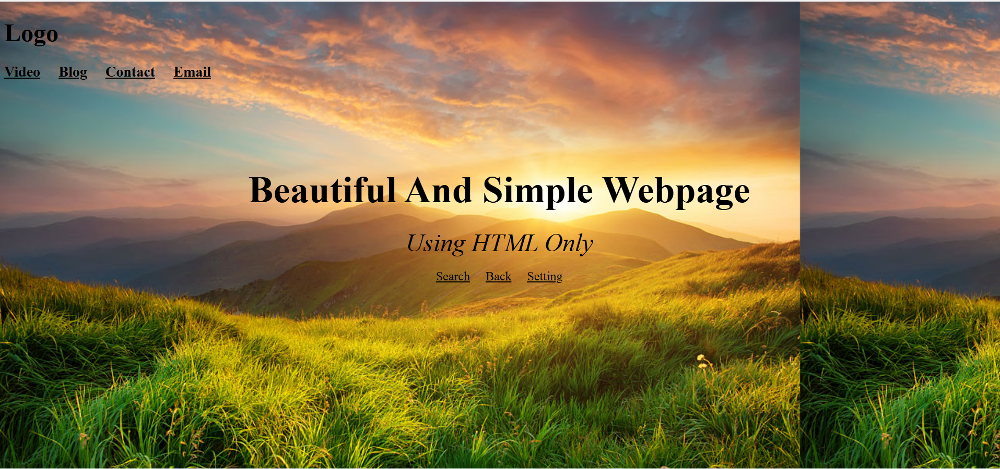

# Demo 01 - Beautiful and Simple Webpage

## About

This is my first simple webpage created using HTML only. I tried different HTML tags to make the webpage look good. I added headings, text, navigation items and a background image.

## HTML Tags I Used

- `<html>` - Main HTML tag
- `<head>` - Contains page information
- `<meta>` - Used for character encoding and viewport
- `<title>` - Sets the page title
- `<body>` - Contains all webpage content
- `<h1>` - Used for the main heading
- `<h3>` - Used for subheadings
- `` - Changes text size and color
- `
` - Aligns content in the center
- `<u>` - Underlines text
- `<i>` - Makes text italic
- `
` - Used to write paragraphs
- ` ` - Adds a line break
- `&nbsp;` - Adds extra space

## What I Created

- A simple logo using text
- Navigation menu (Video, Blog, Contact and Email)
- Main heading and subtitle
- Search, Back and Setting options
- Background image

## Output

## What I Learned

- How to create a basic HTML page
- How to use different HTML tags
- How to add headings and paragraphs
- How to change text size, color and style
- How to add a background image
- How HTML tags work together to create a webpage

## Author

Mayur Thorat