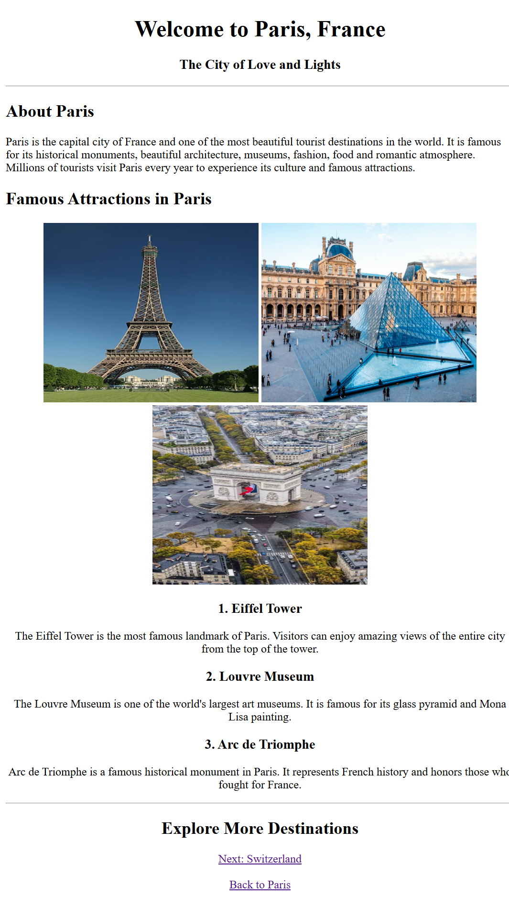
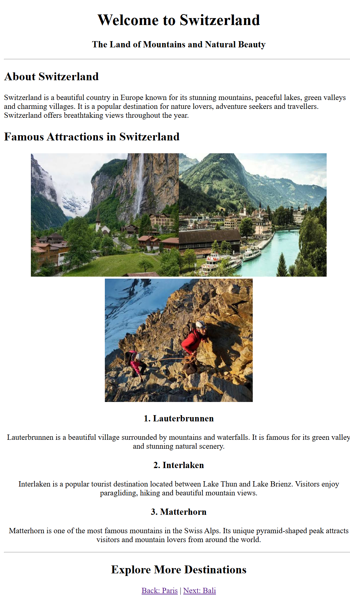
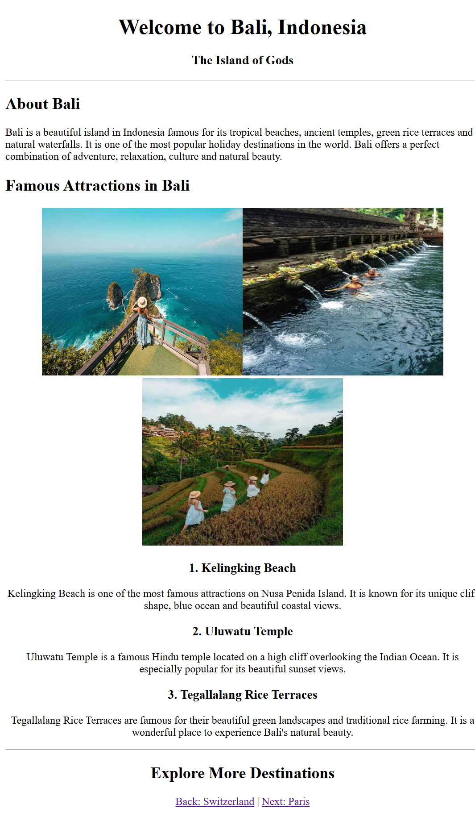

# Demo 03 - Travel Explorer

## About

In this demo, I created a multi-page travel website using HTML. It includes three destinations: Paris, Switzerland, and Bali. Each page contains destination information, famous attractions, images, and navigation links to move between pages.

## HTML Tags Used

- `<html>` - Main HTML tag.
- `<head>` - Contains page information.
- `<meta>` - Used for character encoding and viewport.
- `<title>` - Sets the page title.
- `<body>` - Contains the webpage content.
- `
` - Aligns content to the center.
- `<h1>` - Displays the main heading.
- `<h2>` - Displays section headings.
- `<h3>` - Displays subheadings.
- `
` - Used to write paragraphs.
- `
` - Creates a horizontal line.
- `` - Used to display images.
- `<a>` - Used to create links.
- ` ` - Adds a line break.

## What I Created

- Three separate destination pages.
- Paris, Switzerland, and Bali travel information.
- Images of famous tourist attractions.
- Navigation links between all three pages.
- Separate folders for destination images.

## What I Learned

- How to create multiple HTML pages.
- How to display images using the image tag.
- How to use the `src` and `alt` attributes.
- How to connect pages using anchor tags.
- How to use relative file paths.
- How to organize project files and folders.

## Output

### Paris

### Switzerland

### Bali

## Author

Mayur Thorat