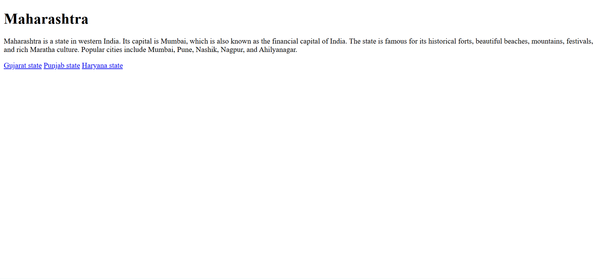
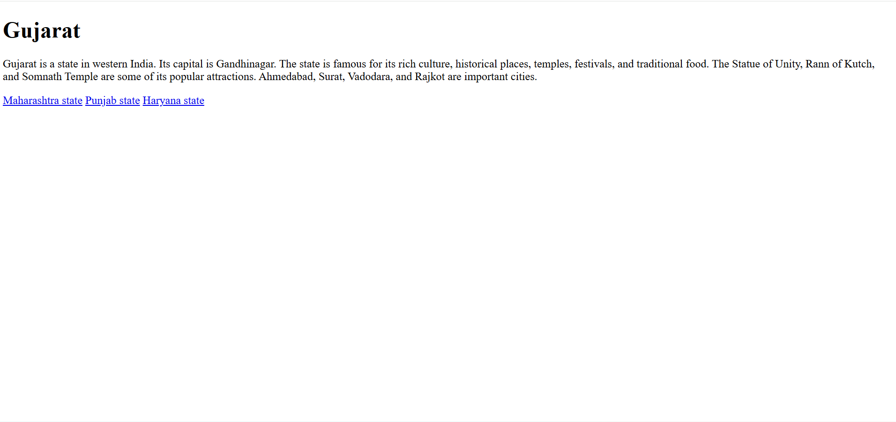
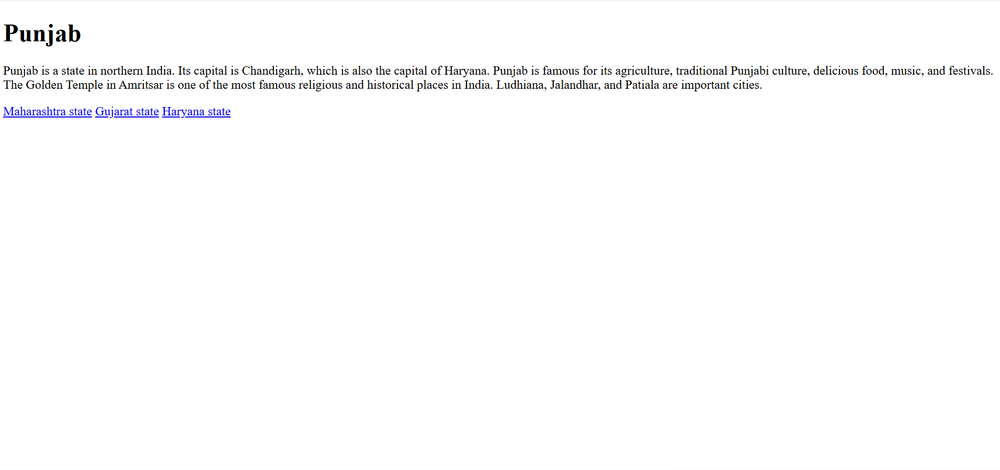
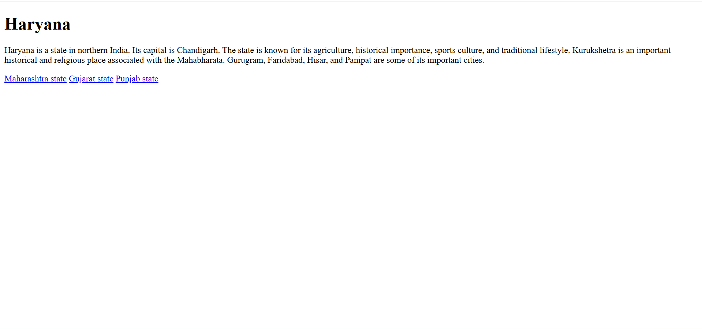

# Demo 04 - Indian State Explorer

## About

In this demo, I created a multi-page Indian State Explorer website using HTML. It includes four Indian states: Maharashtra, Gujarat, Punjab, and Haryana. Each page contains basic information about the state and navigation links to move between all four state pages.

## HTML Tags Used

- `<!DOCTYPE html>` - Defines the HTML document type.
- `<html>` - Main HTML tag.
- `<head>` - Contains page information.
- `<body>` - Contains the webpage content.
- `<h1>` - Displays the main heading.
- `
` - Used to write paragraphs.
- `<a>` - Used to create links.

## What I Created

- Four separate HTML pages.
- Maharashtra, Gujarat, Punjab, and Haryana state information.
- Navigation links between all four state pages.
- Separate folders for each state.
- Output screenshots of all four webpages.

## What I Learned

- How to create multiple HTML pages.
- How to use heading and paragraph tags.
- How to connect multiple HTML pages using anchor tags.
- How to use relative file paths.
- How to navigate between different folders.
- How to organize project files and folders.

## Output

### Maharashtra

### Gujarat

### Punjab

### Haryana

## Author

Mayur Thorat