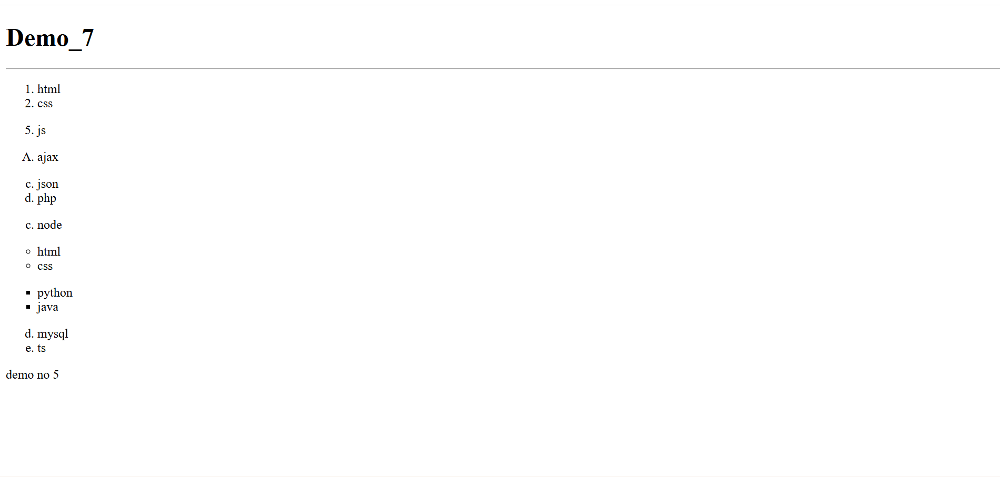

# Demo 05 - HTML Lists

## About

In this demo, I created an HTML webpage to practice different types of ordered and unordered lists. It includes numbered lists, alphabetical lists, and different bullet styles using HTML list attributes.

## HTML Tags Used

- `<!DOCTYPE html>` - Defines the HTML document type.
- `<html>` - Main HTML tag.
- `<head>` - Contains page information.
- `<meta>` - Defines metadata of the webpage.
- `<title>` - Sets the webpage title.
- `<body>` - Contains the webpage content.
- `<h1>` - Displays the main heading.
- `
` - Creates a horizontal line.
- `<ol>` - Creates an ordered list.
- `<ul>` - Creates an unordered list.
- `<li>` - Defines a list item.

## What I Created

- Ordered lists with numbers.
- Ordered lists with uppercase and lowercase letters.
- Numbering using the `start` attribute.
- Unordered lists with circle bullets.
- Unordered lists with square bullets.
- Different list styles using the `type` attribute.

## What I Learned

- How to create ordered lists using `<ol>`.
- How to create unordered lists using `<ul>`.
- How to add list items using `<li>`.
- How to change numbering styles using the `type` attribute.
- How to start numbering from a specific value using the `start` attribute.
- How to create different bullet styles.
- How to organize webpage content using HTML lists.

## Output

## Author

Mayur Thorat