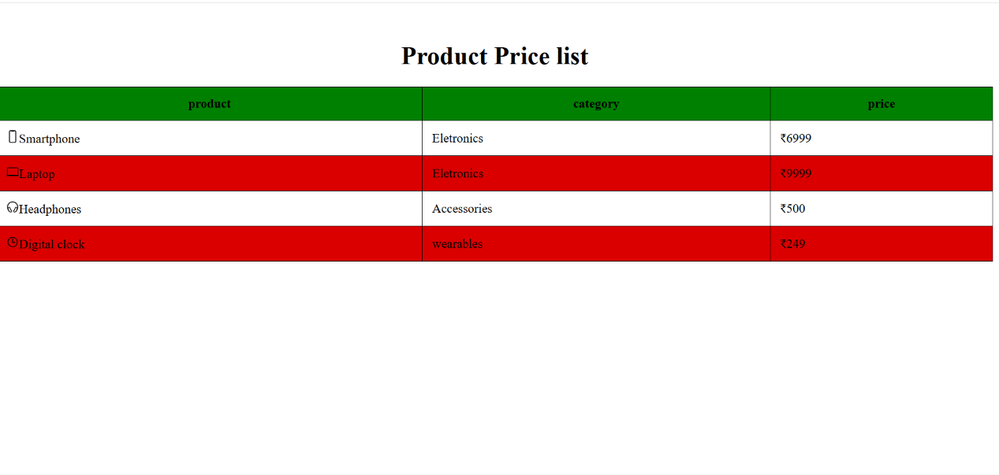

# Demo 07 - HTML Product Price List

## About

In this demo, I created a product price list using an HTML table. It contains different products like Smartphone, Laptop, Headphones, and Digital Clock. I added product categories, prices in Indian Rupees, and icons using Ionicons.

## HTML Tags Used

- `<!DOCTYPE html>` - Defines the HTML document.
- `<html>` - Main HTML tag.
- `<head>` - Contains page information.
- `<meta>` - Provides information about the webpage.
- `<title>` - Sets the page title.
- `<script>` - Connects the Ionicons library.
- `<body>` - Contains webpage content.
- `<table>` - Creates a table.
- `<caption>` - Adds a table title.
- `<tr>` - Creates a table row.
- `<th>` - Creates table headings.
- `<td>` - Adds table data.
- `<ion-icon>` - Displays icons.

## HTML Attributes Used

- `width` - Sets the table width.
- `height` - Sets the table height.
- `border` - Adds a table border.
- `cellpadding` - Adds space inside table cells.
- `bgcolor` - Changes the background color.
- `style` - Adds CSS styling.

## What I Created

- Created a product price list.
- Added four different products.
- Added product categories and prices.
- Used Indian Rupee symbol.
- Added icons using Ionicons.
- Used different background colors.
- Added table borders and spacing.

## What I Learned

- How to create a product table.
- How to use the caption tag.
- How to add product details using table rows and columns.
- How to display the Indian Rupee symbol.
- How to use external icon libraries.
- How to add icons using Ionicons.
- How to apply background colors to table rows.

## Output

## Author

Mayur Thorat