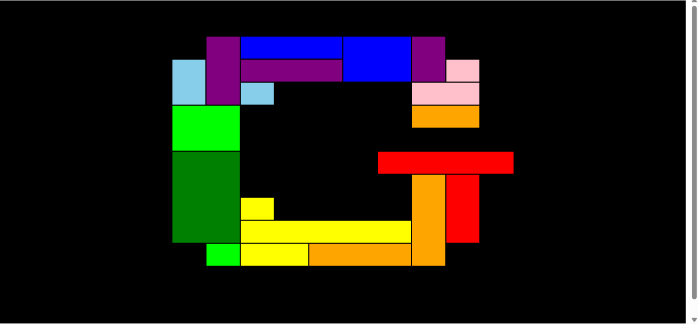

# Demo 08 - HTML Pixel Art Using Tables

## About

In this demo, I created a pixel art design using an HTML table. I used different background colors and merged table cells to create a colorful pattern.

## HTML Tags Used

- `<!DOCTYPE html>` - Defines the HTML document.
- `<html>` - Main HTML tag.
- `<head>` - Contains page information.
- `<body>` - Contains webpage content.
- `<table>` - Creates a table.
- `<tr>` - Creates a table row.
- `<td>` - Creates a table data cell.
- `<th>` - Creates a table heading cell.

## HTML Attributes Used

- `width` - Sets the width of the table or cell.
- `height` - Sets the height of a table row.
- `bgcolor` - Changes the background color.
- `colspan` - Merges multiple columns into one cell.
- `rowspan` - Merges multiple rows into one cell.

## What I Created

- Created a pixel art design using an HTML table.
- Used 20 columns to create the design.
- Added different background colors.
- Used colspan and rowspan to merge cells.
- Created a colorful pattern using table cells.

## What I Learned

- How to create pixel art using HTML tables.
- How to create rows and columns.
- How to merge cells using colspan.
- How to merge rows using rowspan.
- How to apply different background colors.
- How to control table row height and column width.

## Output

## Author

Mayur Thorat