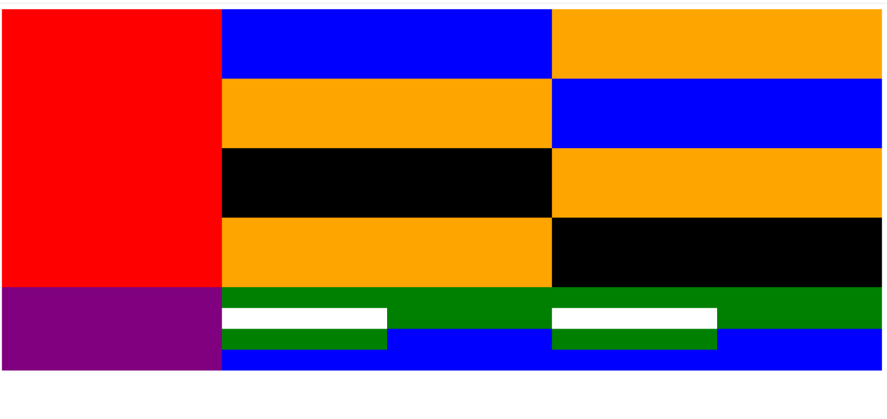

# Demo 09 - HTML Layout Using Div and Float

## About

In this demo, I created a colorful layout using HTML `div` elements and CSS inline styling. I used different background colors, heights, widths, and the `float: left` property to arrange multiple sections horizontally. I also created nested div elements to make the layout more interesting.

## HTML Tags Used

- `<!DOCTYPE html>` - Defines the HTML document.
- `<html>` - Main HTML tag.
- `<head>` - Contains page information.
- `<meta>` - Defines metadata for the webpage.
- `<title>` - Sets the webpage title.
- `<body>` - Contains webpage content.
- `
` - Creates sections or containers.

## CSS Properties Used

- `height` - Sets the height of an element.
- `width` - Sets the width of an element.
- `background` - Sets the background color.
- `background-color` - Changes the background color.
- `float: left` - Aligns elements to the left.
- `margin-top` - Adds space above an element.

## What I Created

- Created a colorful layout using HTML div elements.
- Used different heights and widths to create rectangular sections.
- Added multiple background colors such as red, blue, orange, black, purple, green, and white.
- Used `float: left` to arrange div elements horizontally.
- Created nested div elements inside parent div elements.
- Used percentage-based widths to control the layout.

## What I Learned

- How to create layouts using HTML div elements.
- How to apply inline CSS styling.
- How to control element height and width.
- How to use the CSS float property.
- How to arrange multiple div elements horizontally.
- How to create nested div elements.
- How to apply background colors and margins.

## Output

## Author

Mayur Thorat