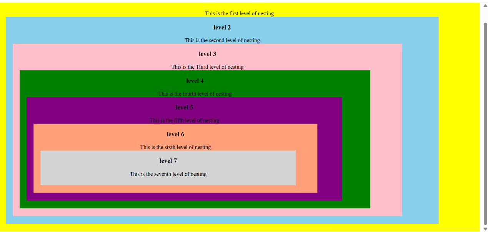

# Demo 10 – HTML Nested Div Layout

## Description

This project demonstrates seven levels of nested HTML div elements. Each div is placed inside its parent container with different background colors, heights, and widths.

## Concepts Covered

- HTML div element
- Nested div elements
- Inline CSS
- Height and Width
- Background Color
- Float Property
- Margin Property

## Technologies Used

- HTML5
- CSS3 (Inline CSS)

## Project Structure

- index.html – Main HTML file
- output.png – Browser output screenshot

## Output

## Learning Outcome

Learned how nested div elements work and how parent and child containers are structured in HTML.

## Author

Mayur Thorat