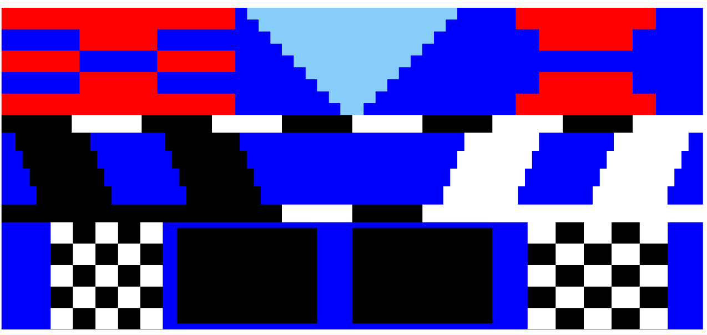

# Demo 11 – Advanced Nested Div Layout

## Description

This project demonstrates an advanced layout structure created using multiple HTML div elements. Different colored rectangular sections are arranged horizontally and vertically using inline CSS, float properties, and percentage-based dimensions to create a complex multicolor design.

## Concepts Covered

- HTML Div Element
- Nested Div Elements
- Multiple Div Containers
- Inline CSS
- Height and Width Properties
- Background Color
- Float Left and Float Right
- Percentage-Based Width
- Center Alignment
- Horizontal and Vertical Layout
- Repeated Div Elements
- HTML Comments

## Technologies Used

- HTML5
- CSS3 (Inline CSS)

## Project Structure

- index.html – Main HTML file
- output.png – Browser output screenshot

## Output

## Learning Outcome

Learned how to create complex layouts using multiple div containers, arrange elements horizontally and vertically, manage dimensions using percentages, and apply different background colors using inline CSS and float properties.

## Author

Mayur Thorat