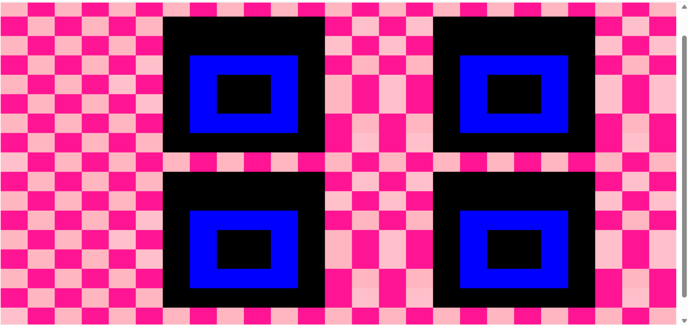

# Demo 12 - Advanced Div-Based Pixel Art Layout

## About This Demo

Today I created a pixel-art layout using HTML `div` elements and inline CSS.

I used different background colors and arranged multiple div blocks to create a large pixel-style design. I also practiced using the float property to place the blocks next to each other.

## What I Practiced

- Using HTML `div` elements
- Adding inline CSS
- Using the `float` property
- Setting height and width
- Applying different background colors
- Using percentage-based widths
- Creating layouts with nested divs
- Repeating div elements to build a design

## Technologies Used

- HTML5
- CSS3

## Project Files

```text
demo-12-html-advanced-pixel-art-layout/
│
├── index.html
├── README.md
└── output.png
```

## What I Learned

While creating this demo, I got more practice with div elements and CSS properties. I understood how multiple colored blocks can be arranged together to create a pixel-art design.

I also practiced using float, height, width, and background colors.

## Output



## Daily Learning Progress

**Day 12 - HTML & CSS Practice**

Completed my 12th HTML practice demo. Practiced creating a pixel-art layout using multiple div elements and different CSS properties.

Continuing my HTML and CSS learning journey, one demo at a time.