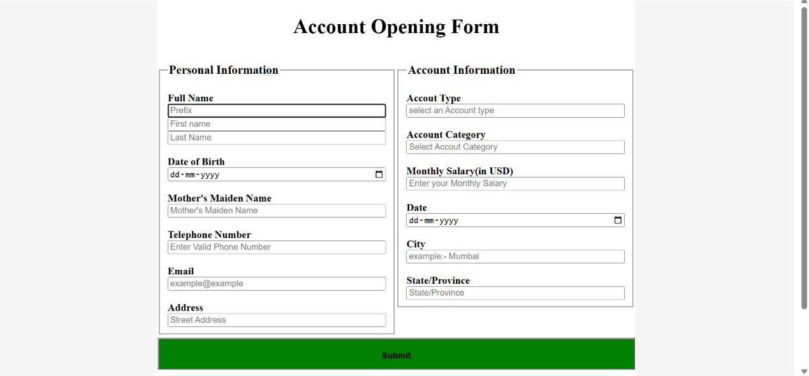

# Demo 13 - HTML Account Opening Form

## About This Demo
In this demo, I created an Account Opening Form using HTML and inline CSS. The form is divided into two main sections: Personal Information and Account Information.

I used div elements to create the page layout and float property to arrange the sections side by side.

## Features
- Account Opening Form heading
- Personal Information section
- Account Information section
- Full Name, Date of Birth and Contact fields
- Email and Address fields
- Account Type and Account Category fields
- Monthly Salary, Date, City and State fields
- Submit button

## HTML Tags and Concepts Used
- `
`
- `<form>`
- `<fieldset>`
- `<legend>`
- `<label>`
- `<input>`
- `<button>`
- `<h1>`, `<h3>`, `<h4>`
- ` `
- Inline CSS
- Float property
- Width and Height

## Output

## What I Learned
In this demo, I learned how to create an account opening form using different HTML input fields. I also practiced using fieldset and legend tags to group form elements and div with float to create a two-column layout.