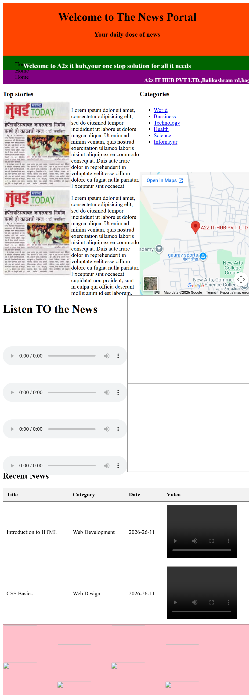

# Demo 14 - HTML News Portal Layout

## About This Demo
In this demo, I created a simple News Portal webpage using HTML and CSS. I used different div sections to create the layout and added news-related content, images, audio, videos and other elements.

## Features
- News Portal Header with title and subtitle
- Navigation Menu
- Moving News Ticker using Marquee
- Top Stories section with images and text
- News Categories with links
- Google Maps using iframe
- Audio News section with audio controls
- YouTube Videos using iframe
- Recent News Table
- Moving Image Gallery using Marquee

## HTML Tags Used
- div
- h1, h2, h3, h4
- ul, li
- a
- img
- marquee
- audio, source
- iframe
- table, tr, th, td
- video

## CSS Properties Used
- height
- width
- background-color
- float
- display
- padding
- border
- border-collapse
- text-align
- border-radius

## What I Learned
In this demo, I practiced creating a large webpage using nested divs and float properties. I also learned how to add audio, video, images, Google Maps, tables and scrolling text in an HTML webpage.

## Output

