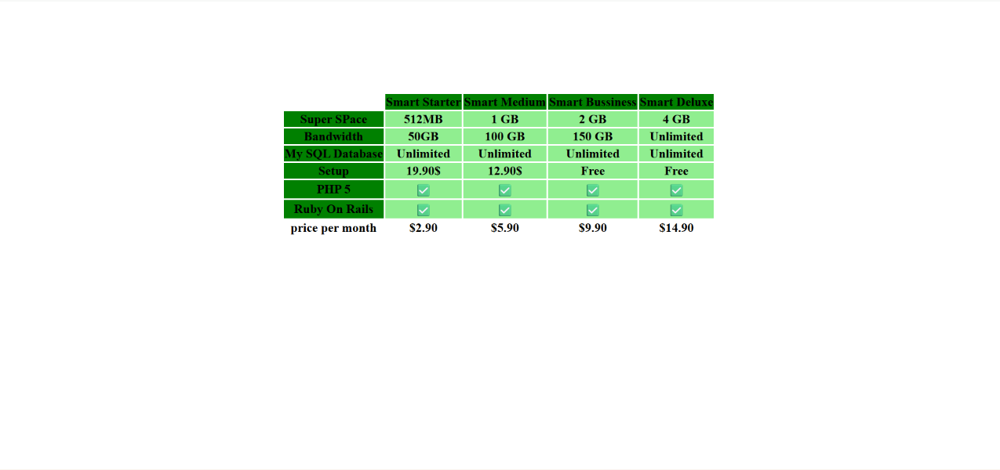

# Demo 06 - HTML Tables

## About

In this demo, I created a table using HTML. The table shows four different hosting plans: Smart Starter, Smart Medium, Smart Business, and Smart Deluxe. It contains details like storage, bandwidth, database, setup charges, and monthly prices.

## HTML Tags Used

- `<!DOCTYPE html>` - Defines the HTML document.
- `<html>` - Main HTML tag.
- `<head>` - Contains page information.
- `<meta>` - Provides information about the webpage.
- `<title>` - Sets the page title.
- `<body>` - Contains webpage content.
- `
` - Aligns content in the center.
- ` ` - Adds a line break.
- `<table>` - Creates a table.
- `<tr>` - Creates a table row.
- `<th>` - Creates a table heading.
- `
` - Adds a horizontal line.

## HTML Attributes Used

- `bgcolor` - Changes the background color.
  
## What I Created

- Created a hosting plan comparison table.
- Added four different hosting plans.
- Added storage and bandwidth details.
- Added database and setup information.
- Added PHP 5 and Ruby on Rails support.
- Added monthly prices.
- Used different background colors.
- Added checkmark symbols.

## What I Learned

- How to create a table in HTML.
- How to add rows and columns.
- How to use the `<table>`, `<tr>`, and `<th>` tags.
- How to change background colors.
- How to display information in table format.
- How to use HTML symbols.

## Output

## Author

Mayur Thorat